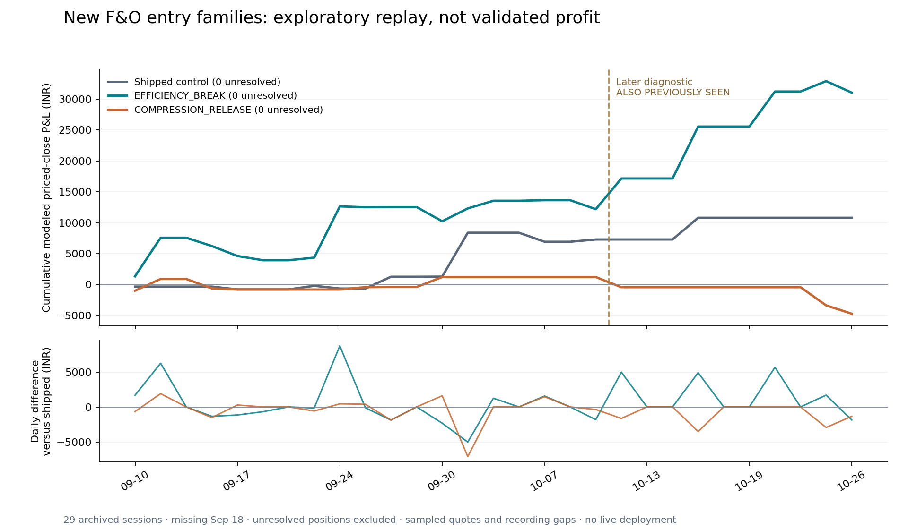

# O27e: learning from novel F&O entry-family evolution

**Verdict: exploratory research only. No untouched validation; keep the shipped book.**

Study date: 2026-10-27. Frozen source commit: `3e2bcfe`. All dates are previously seen.
NIFTY single-leg portfolio proxy only; results must not be summed with other books.



The chart accumulates day-end priced closes; reported drawdown uses the finer closed-trade path.

## What was actually run

- 3 new entry families; 121 distinct genomes, including one-step neighbours.
- 115 distinct development-period trade histories; parameter combinations are not independent experiments.
- Three separate populations of eight, five generations; tournament selection, uniform crossover, 18% per-gene mutation, elites and immigrants.
- Search: Sep 10–Oct 9, 19 archived sessions. Two family leaders frozen before Oct 12–26 diagnostics (10 sessions, also seen).
- New predicates relative to O27/O27b: efficiency-filtered rolling break, compressed rolling-range release and opening-range failed-auction reversal.
- Shared planner, options selection, costs, sizing, risk brakes and exit ladder reused. No runtime source changes.
- The previous CURRENT receipt reproduces exactly; 14 new synthetic checks and 43 existing F&O regressions passed before scoring.

## Full-window priced-close results

These are modeled outcomes of recorded quotes, not actual executions. Unresolved positions have no invented sale or P&L.
Drawdown is on closed-trade P&L; it excludes intratrade marked losses.

| Arm | Closed / unresolved | Net INR | Charges INR | Win rate | PF | Closed-trade DD INR | Net minus best day | Fixed-trade stressed net |
|---|---:|---:|---:|---:|---:|---:|---:|---:|
| Shipped control | 13 / 0 | 10,801.09 | 931.41 | 53.8% | 2.99 | 1,990.89 | 3,693.42 | 8,878.24 |
| EFFICIENCY_BREAK ed0d136bdd80ee89 | 38 / 0 | 31,063.33 | 2,795.18 | 55.3% | 2.28 | 6,748.74 | 22,655.57 | 25,034.53 |
| COMPRESSION_RELEASE 44e24db7c965d7b1 | 13 / 0 | -4,731.68 | 896.68 | 46.2% | 0.58 | 7,584.69 | -6,627.78 | -6,645.85 |

Fixed-trade stress subtracts INR 1 per option unit on each side and adds 25% to charges. It holds the trade list fixed; sizing, gates and halts are not resimulated.

## Search versus later seen-data diagnostics

| Family | Genomes evaluated | Eligible on A |
|---|---:|---:|
| EFFICIENCY_BREAK | 42 | 6 |
| COMPRESSION_RELEASE | 40 | 1 |
| FAILED_AUCTION | 39 | 0 |

| Frozen finalist | A net | A trades | Neighbour median fitness | B net | B trades / unresolved | B checks |
|---|---:|---:|---:|---:|---:|---|
| EFFICIENCY_BREAK | 12,192.74 | 25 | -0.827 | 18,870.59 | 13 / 0 | trades=True, priced=True, positive=True, best_day_removed=True, beats_control=True, drawdown=False, stress=True |
| COMPRESSION_RELEASE | 1,204.84 | 8 | -2.307 | -5,936.52 | 5 / 0 | trades=True, priced=True, positive=False, best_day_removed=False, beats_control=False, drawdown=False, stress=False |

B is not an untouched holdout. It was inspected by earlier agents, and late-October days motivated prior ideas. A positive B diagnostic cannot certify an edge.

## Exact finalist genomes

### EFFICIENCY_BREAK ed0d136bdd80ee89

```json
{
  "family": "EFFICIENCY_BREAK",
  "lookback": 4,
  "efficiency": 0.35,
  "buffer": 0.2,
  "body": 0.55,
  "vwap": false,
  "compression": 3.0,
  "rvol": 1.2,
  "stop": 2.0,
  "target": 1.8,
  "exit": "LOOSE"
}
```

### COMPRESSION_RELEASE 44e24db7c965d7b1

```json
{
  "family": "COMPRESSION_RELEASE",
  "lookback": 6,
  "efficiency": 0.55,
  "buffer": 0.2,
  "body": 0.55,
  "vwap": true,
  "compression": 3.0,
  "rvol": 0.8,
  "stop": 1.5,
  "target": 1.2,
  "exit": "LOOSE"
}
```

## Execution sensitivity and recording gaps

| Arm | Strict closed / unresolved | Strict priced net | LTP exits (primary) | Insufficient entry / exit depth (primary) |
|---|---:|---:|---:|---:|
| Shipped control | 13 / 0 | 10,486.22 | 0 | 0 / 0 |
| EFFICIENCY_BREAK ed0d136bdd80ee89 | 38 / 0 | 35,139.90 | 0 | 0 / 2 |
| COMPRESSION_RELEASE 44e24db7c965d7b1 | 13 / 0 | -4,715.51 | 0 | 0 / 0 |

Strict diagnostics require both-sided displayed depth for maximum allowed lots at entry, and a positive bid covering the held quantity at exit. They can change admissions and book history; they are an execution-sensitivity scenario, not exact live parity.

- Archive: 29 of 30 expected exchange sessions. September 18 is unavailable, never assigned zero profit.
- Eight recorded sessions contain gaps longer than 180 seconds. October 13 has an approximately 95-minute gap; October 16 ends around 10:08 IST.
- Every day is retained. The audit lists each closed hold crossing a recording gap; there are no interpolated quotes or perfect intragap stops.
- NSE expiry policy/holiday circular independently confirm the six expiry dates in the study, including October 19. Contract lot/token details still come from archived packets.
- Sampling is about 60 seconds versus about 10 seconds live. Partial fills, queue position, broker rejection, shared capital reservations and a fully counterfactual spread book are not reproduced.

## Supplemental uncertainty diagnostic

Post hoc descriptive 3-session moving-block bootstrap, 3,000 draws, fixed seed; intervals are for mean daily candidate-minus-control P&L on these same seen observations. They are not a future-profit probability, a multiple-testing correction or a selection gate.

- EFFICIENCY_BREAK ed0d136bdd80ee89: INR -298.17 to 1,605.34 per archived session.
- COMPRESSION_RELEASE 44e24db7c965d7b1: INR -1,037.31 to -83.25 per archived session.

## Learning

1. **More modeled profit did not establish better consistency.** Efficiency break earned INR 31,063.33 versus 10,801.09 for the shipped control, but closed-trade drawdown rose from 1,990.89 to 6,748.74. Net divided by that drawdown fell from 5.43 to 4.60. Its later seen-period drawdown exceeded the frozen INR 5,000 cap; do not promote it.

2. **The useful hypothesis is a local trend-quality filter.** The selected candidate requires a new break of the preceding four completed 5-minute bars, a 0.2-ATR buffer, path efficiency >=0.35, candle body fraction >=0.55 and relative volume >=1.2. It adds no VWAP direction gate. The planner uses the tighter structural/2-ATR stop, 1.8R target and LOOSE exit (60-minute limit, 1.5-ATR trail, profit lock off). The inherited regime, risk and expiry gates remain. Whether the local channel or the looser exit contributes the edge needs a separately frozen ablation; this search cannot assign causation.

3. **Some neighbours survive, but the region is fragile.** These are A-only one-gene changes, never later-period retunes: reducing RVOL 1.2 to 1.0 changes net from +12,192.74 to -8,230.54; changing LOOSE to PATIENT gives -8,842.66. Other neighbours remain profitable: lookback 4 to 6 gives +10,487.66; body 0.55 to 0.35 gives +17,400.59; target 1.8R to 2.4R gives +14,047.33. The complete neighbour-median fitness is -0.827. This is not a broad robust plateau.

4. **Profitable often is not profitable every day.** Efficiency has 21 winning trades out of 38 (55.3%) and 12 green / 7 red / 19 active recorded sessions. That is 63.2% of active sessions, or 41.4% of all 29 archived sessions. Ten sessions have no modeled close; missing September 18 is unknown. The control has 6 green / 4 red / 10 active sessions. These are descriptive frequencies, not estimated future success rates.

5. **Costs alone do not explain the failure.** Efficiency remains +25,034.53 under the frozen extra-cost arithmetic, and +22,655.57 after removing its best day. Removing its single best trade leaves +23,207.97 (control +3,693.42; compression -6,735.87). Nevertheless, risk failure, parameter sensitivity and a paired daily-difference interval crossing zero remain.

6. **Keep unsuccessful families in the record.** Of 121 evaluated genomes, 46 earn positive A net but only seven pass all A criteria. Failed-auction reversal has no eligible arm. The frozen compression leader is already ineligible on A and loses 5,936.52 on B; one eligible compression neighbour is not substituted after selection. This rejects these tested configurations, not every possible reversal/compression strategy.

7. **Next useful work is fresh evidence and recording quality.** Keep the shipped rules and the existing six-arm O27c panel unchanged. Repair/archive quote coverage through a separate engineering change, especially continuous bid/depth and intratrade marks. If the owner chooses a prospective comparison, register the exact candidate, control, sample horizon, drawdown/cost gates and stopping rules before collecting new sessions; no daily retuning or early winner declaration. No amount of additional tuning on these dates creates untouched validation.

8. **Evidence-helper limitation is preserved.** The supplied helper binds the initial Git HEAD as well as source hashes. Committing the required pre-score freeze legitimately changed HEAD, so its generated REPORT is INVALID for that metadata mismatch. Its failure is retained; no frozen receipt/helper is rewritten. The separate verify_study.py checks ancestor commits, every frozen input/source hash, raw-data bindings, report integrity and ledger arithmetic without claiming that the original helper passed. Neither audit certifies future profitability.

## Independent checks and status

- 128 closed-trade records checked against recorded entry asks, exit bids/LTP, quantity, fees, causal clocks and expiry restrictions.
- All 121 searched-arm metric receipts reconcile to their trade lists.
- Dataset/source hashes reverified after scoring. Production Git SHA/status unchanged; no broker calls, orders, runtime changes, deployments or new recurring tasks.
- Existing unrelated Dev changes were preserved. Freeze and results are local research commits; no push or promotion is implied.
- Original documentation check hit a Windows cp1252 decoding error; explicit UTF-8 recheck passed. No research rule changed.
- Plot dependencies, if used, are installed only in this study’s ignored `_local/plot-packages`, not the shared venv.

## Daily modeled priced-close P&L

| Session | Shipped | Finalist 1 | Finalist 2 |
|---|---:|---:|---:|
| 2026-09-10 | -343.52 | 1,323.78 | -1,004.44 |
| 2026-09-11 | 0.00 | 6,246.27 | 1,896.10 |
| 2026-09-15 | 0.00 | 0.00 | 0.00 |
| 2026-09-16 | 0.00 | -1,347.77 | -1,528.55 |
| 2026-09-17 | -456.79 | -1,611.93 | -182.72 |
| 2026-09-21 | 0.00 | -684.09 | 0.00 |
| 2026-09-22 | 0.00 | 0.00 | 0.00 |
| 2026-09-23 | 582.64 | 423.99 | 0.00 |
| 2026-09-24 | -440.14 | 8,291.95 | 0.00 |
| 2026-09-25 | 0.00 | -128.13 | 383.56 |
| 2026-09-28 | 1,910.58 | 25.75 | 25.75 |
| 2026-09-29 | 0.00 | 0.00 | 0.00 |
| 2026-09-30 | 19.99 | -2,307.25 | 1,615.14 |
| 2026-10-01 | 7,107.67 | 2,081.42 | 0.00 |
| 2026-10-05 | 0.00 | 1,242.41 | 0.00 |
| 2026-10-06 | 0.00 | 0.00 | 0.00 |
| 2026-10-07 | -1,460.92 | 93.34 | 0.00 |
| 2026-10-08 | 0.00 | 0.00 | 0.00 |
| 2026-10-09 | 366.36 | -1,457.00 | 0.00 |
| 2026-10-12 | 0.00 | 4,967.61 | -1,649.46 |
| 2026-10-13 | 0.00 | 0.00 | 0.00 |
| 2026-10-14 | 0.00 | 0.00 | 0.00 |
| 2026-10-15 | 3,515.21 | 8,407.76 | 0.00 |
| 2026-10-16 | 0.00 | 0.00 | 0.00 |
| 2026-10-19 | 0.00 | 0.00 | 0.00 |
| 2026-10-21 | 0.00 | 5,670.97 | 0.00 |
| 2026-10-22 | 0.00 | 0.00 | 0.00 |
| 2026-10-23 | 0.00 | 1,686.44 | -2,941.22 |
| 2026-10-26 | 0.00 | -1,862.19 | -1,345.83 |
